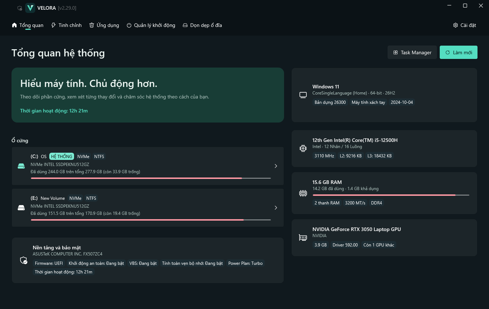

<div align="center">


# VELORA

**Windows của bạn. Rõ ràng hơn.**

Không gian chăm sóc Windows: hiểu hệ thống, tinh chỉnh có chủ đích,
quản lý ứng dụng và lấy lại dung lượng.

[Tính năng](#tính-năng) · [Chạy dự án](#chạy-dự-án) · [Kịch bản demo](fasterLegit/DEMO.md)

</div>



## Vì sao VELORA?

Mỗi thay đổi trên máy tính đều cần được hiểu rõ trước khi áp dụng. VELORA
tập hợp thông tin phần cứng và các công cụ bảo trì vào một giao diện thống
nhất. Người dùng xem mô tả, cân nhắc rủi ro và tự chọn thao tác; ứng dụng
ghi lại kết quả và lưu dữ liệu hoàn tác cho thay đổi có hỗ trợ khôi phục.

## Tính năng

| Không gian | Công việc |
| --- | --- |
| **Tổng quan** | Xem CPU, RAM, GPU, ổ đĩa, Windows, firmware, bảo mật và thời gian hoạt động |
| **Tinh chỉnh** | Xem xét các thay đổi trải nghiệm Windows và quyền riêng tư |
| **Thư viện ứng dụng** | Kiểm tra ứng dụng AppX đã cài và chọn ứng dụng muốn gỡ |
| **Quản lý khởi động** | Xem và bật/tắt các mục được hỗ trợ chạy cùng Windows |
| **Dọn dẹp ổ đĩa** | Quét, chọn và xóa tệp tạm; xem dung lượng trước khi thực hiện |

Giao diện tiếng Việt, hai chế độ sáng/tối, tìm kiếm, lọc và trạng thái tải,
trống, lỗi. Logo chữ V cùng bảng màu xanh ngọc tạo nhận diện xuyên suốt.

## Cách sử dụng

1. Mở VELORA với quyền quản trị viên.
2. Xem **Tổng quan** để hiểu cấu hình và trạng thái máy.
3. Chọn công cụ, đọc mô tả và xem rủi ro của thao tác.
4. Chỉ chọn mục cần xử lý, sau đó xác nhận thực hiện.
5. Kiểm tra kết quả; dùng hoàn tác khi thao tác đó có hỗ trợ.

Xóa tệp và một số thao tác gỡ ứng dụng không thể hoàn tác. Sao lưu dữ liệu
quan trọng và tạo điểm khôi phục trước khi thay đổi hệ thống.

## Chạy dự án

Yêu cầu Windows 10/11 và .NET 10 SDK. Quy trình build đặt SDK, package,
cache và tệp tạm ngay trong dự án trên ổ đĩa hiện tại.

```powershell
.\fasterLegit\build.ps1 restore
.\fasterLegit\build.ps1 build
.\fasterLegit\build.ps1 run
```

Đóng gói bản Windows x64 chạy độc lập, không cần cài thêm .NET trên máy chạy:

```powershell
.\fasterLegit\build.ps1 publish
```

Mở `fasterLegit/Release/VELORA/VELORA.exe`. Giữ các tệp đi kèm trong cùng thư mục.

Nếu chưa có SDK, giải nén .NET 10 SDK cho Windows vào
`fasterLegit/.tools/dotnet`. Thư mục kỹ thuật của solution được giữ ổn định
để các lệnh build và dữ liệu hiện có tiếp tục tương thích.

Chạy kiểm thử từ terminal quản trị viên trên máy thử nghiệm:

```powershell
.\fasterLegit\build.ps1 test
```

## Tài liệu

- [Kịch bản trình diễn](fasterLegit/DEMO.md)
- [Quy chuẩn giao diện](DESIGN.md)
- [Luồng xử lý](fasterLegit/FLOW_VA_CO_CHE_TOI_UU_HOA.md)
- [Hướng dẫn phát triển](CONTRIBUTING.md)
- [Quyền riêng tư](PRIVACY.md), [Điều khoản](TERMS.md), [Lưu ý sử dụng](DISCLAIMER.md)

Giấy phép và thông báo bản quyền được lưu trong [LICENSE](LICENSE)
và [THIRD-PARTY-NOTICES.md](THIRD-PARTY-NOTICES.md).
